<picture>
  <source media="(prefers-color-scheme: dark) and (max-width: 640px)" srcset="assets/terminal-mobile-dark.svg">
  <source media="(prefers-color-scheme: light) and (max-width: 640px)" srcset="assets/terminal-mobile-light.svg">
  <source media="(prefers-color-scheme: dark)" srcset="assets/terminal-desktop-dark.svg">
  
</picture>

I build native Mac apps and practical tools, with an interest in local files and thoughtful desktop interactions.

### On the workbench

| Project | The idea | Try it |
| :--- | :--- | :--- |
| **ChordShot** | Hold, drag, capture. A mouse chord or trackpad gesture becomes a screenshot; Space switches the selection to silent video. | [Free Mac beta](https://github.com/rcox-shome/chordshot-releases) |
| **Nodetaker** | Give your notes room to think. Arrange notes, media, and connections on a spatial canvas backed by a local Markdown vault. | [Overview & downloads](https://github.com/rcox-shome/nodetaker-releases) |
| **Folder Reader** | A bookmark for the whole folder. Read mixed files in one Mac window, remember your PDF page, and track what you have reviewed. | [Experimental preview](https://github.com/rcox-shome/folder-reader-releases) |
| **Password Anywhere** | Generate a password from a global shortcut. Native macOS integration, no third-party packages, and clipboard cleanup that preserves newer content. | [Source](https://github.com/rcox-shome/password-anywhere) |

### Under the hood

Password Anywhere is a small Swift codebase you can read end to end. Two places to start: [unbiased random-number selection](https://github.com/rcox-shome/password-anywhere/blob/main/PasswordAnywhere/PasswordGenerator/SecureRandom.swift) and [guarded clipboard cleanup](https://github.com/rcox-shome/password-anywhere/blob/main/PasswordAnywhere/Clipboard/ClipboardManager.swift).

I'd like to compare notes with people building Mac utilities and local-first software. [Try ChordShot and share what you think](https://github.com/rcox-shome/chordshot-releases/issues/new?template=beta-feedback.yml), or [contribute to Password Anywhere](https://github.com/rcox-shome/password-anywhere/blob/main/CONTRIBUTING.md).

A look at Nodetaker

Example content in the v0.2.0 beta interface. Current releases are linked above.

How this profile works

An original Python generator turns public GitHub data and an ASCII version of my avatar into SVGs for dark, light, and mobile layouts. GitHub Actions refreshes the public repo count, detected languages, and release versions daily.

[Generator & data notes](docs/PROFILE.md) · Terminal-profile inspiration: [Andrew Grant](https://github.com/Andrew6rant/Andrew6rant).

Password Anywhere is open source. ChordShot, Nodetaker, and Folder Reader have public downloads; their application source remains private. Folder Reader is an experimental, unnotarized preview.
